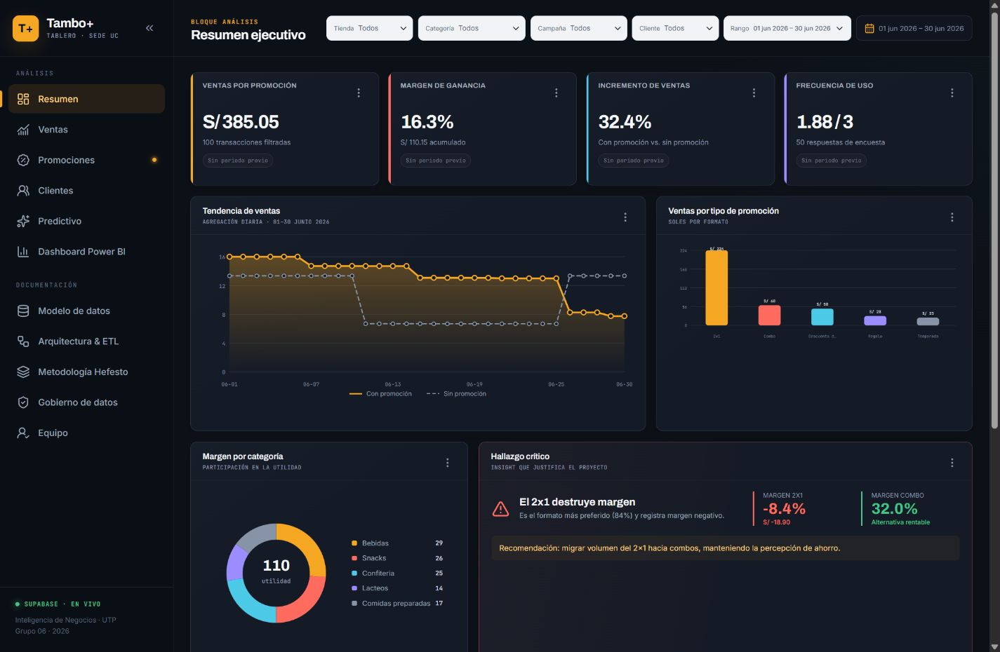

# Tambo BI - DataMart de promociones comerciales

Dashboard académico de Inteligencia de Negocios para evaluar promociones comerciales en **Tambo - Sede UC**. El proyecto implementa un DataMart en copo de nieve sobre PostgreSQL/Supabase, una capa analítica SQL, un modelo predictivo reproducible y una aplicación React desplegable en Vercel.

> Universidad Tecnológica del Perú · Inteligencia de Negocios · Grupo 06 · 2026



## Resultados verificables

| Indicador | Resultado |
|---|---:|
| Transacciones | 100 |
| Ventas totales | S/ 675.95 |
| Ticket promedio | S/ 6.76 |
| Margen acumulado | S/ 110.15 |
| Margen general | 16.3% |
| Ventas con promoción | S/ 385.05 |
| Incremento vs. sin promoción | 32.4% |
| Horario mañana / tarde / noche | 23% / 35% / 42% |
| Encuestas | 50 |
| Segmento de 18-25 años | 25 respuestas |
| Preferencia 2x1 en el segmento | 84% |
| Margen 2x1 | -8.4% (S/ -18.90) |

La migración contiene aserciones que abortan si estas cifras, los descriptivos de encuesta o la integridad referencial no coinciden exactamente.

## Arquitectura


El modelo dimensional normaliza las jerarquías:

- Producto -> Subcategoría -> Categoría y Producto -> Marca.
- Tienda -> Distrito -> Ciudad.
- Promoción -> Tipo de promoción y Promoción -> Campaña.
- Cliente -> Tipo de cliente.
- Tiempo como dimensión de fecha.
- `hecho_ventas` como tabla central y `encuesta_clientes` como fuente separada.

## Stack

- React 19, TypeScript, Vite y React Router.
- TanStack Query para caché, cancelación, reintentos y estados por tile.
- Supabase/PostgreSQL con RLS, vistas `security_invoker` y RPC analíticas.
- CSS propio, Lucide y gráficos SVG responsivos.
- Vercel para hosting y navegación SPA.
- Python estándar para reproducir la regresión lineal múltiple 70/30, semilla 42.

## Ejecución local

Requisitos: Node.js 20 o superior y npm.

```bash
npm install
cp .env.example .env.local
npm run dev
```

En PowerShell, la copia del archivo de entorno se realiza con:

```powershell
Copy-Item .env.example .env.local
```

Completar `.env.local`:

```dotenv
VITE_SUPABASE_URL=https://TU_PROJECT_REF.supabase.co
VITE_SUPABASE_PUBLISHABLE_KEY=sb_publishable_TU_CLAVE
VITE_POWER_BI_EMBED_URL=
```

La clave publicable opera con el rol `anon`. **Nunca usar `service_role`, secret keys o la contraseña de PostgreSQL en el frontend.**

## Recrear el DataMart en Supabase

1. Crear un proyecto Supabase con Data API habilitada.
2. Dejar desactivada la exposición automática de tablas; la migración asigna privilegios explícitos.
3. Vincular el proyecto e instalar toda la base:

```bash
npx supabase@latest login
npx supabase@latest link --project-ref TU_PROJECT_REF
npm run db:apply
npm run db:verify
```

También se puede copiar y ejecutar `supabase/001_datamart_tambo.sql` completo desde el SQL Editor. El script es idempotente: elimina y vuelve a crear únicamente los objetos versionados por este proyecto.

Archivos principales:

- `supabase/001_datamart_tambo.sql`: tablas, restricciones, carga determinística, vistas, RPC, modelo, RLS, permisos, índices y aserciones.
- `supabase/verify_datamart.sql`: consultas de aceptación e integridad.
- `scripts/train_model.py`: entrenamiento reproducible y exportación JSON/SQL.

## Modelo predictivo

El modelo usa regresión lineal múltiple sobre las 100 ventas con una división determinística 70/30 y semilla 42. Incluye porcentaje de descuento, tipo de promoción, categoría, fin de semana, franja horaria y edad del cliente.

```bash
npm run model:train
npm run model:sql
```

Supabase conserva la versión, intercepto, coeficientes originales/estandarizados y las 30 predicciones de prueba. La página Predictivo recalcula R², MAE y RMSE sobre el subconjunto filtrado.

## Filtros y acciones

Los slicers de tienda, categoría, campaña, tipo de cliente y fechas se guardan en la URL y se conservan al navegar. Todas las RPC reciben el mismo contrato de filtros. Cada tile implementa:

- estado de carga, vacío y error con reintento;
- actualización de la consulta;
- descarga CSV del resultado filtrado;
- Fullscreen API con rechazo controlado.

## Power BI

La página `Dashboard Power BI` vive en `src/pages/DashboardPages.tsx`, componente `PowerBiPage`.

1. Publicar el reporte en Power BI.
2. Copiar la URL de inserción que empiece con `https://app.powerbi.com/`.
3. Guardarla como `VITE_POWER_BI_EMBED_URL` en `.env.local` y en Vercel.

Si la variable no existe, la aplicación muestra un placeholder informativo. Si el dominio no es `app.powerbi.com`, el iframe no se renderiza.

## Pruebas y build

```bash
npm test
npm run build
npm run preview
```

La aceptación realizada incluye:

- cifras SQL exactas, cero FK huérfanas y 2x1 con margen negativo;
- lectura y RPC como `anon`, con escrituras rechazadas;
- Supabase Security Advisor sin hallazgos;
- 11 rutas sin errores, filtros sincronizados y limpieza del periodo;
- vistas a 1440 x 940, 1024 x 940 y 390 x 844 px;
- consola sin errores originados por la aplicación.

La comparación visual con el artifact se documenta en [`design-qa.md`](design-qa.md).

## Desplegar en Vercel

```bash
npx vercel@latest
npx vercel@latest --prod
```

Configurar en Preview y Production:

- `VITE_SUPABASE_URL`
- `VITE_SUPABASE_PUBLISHABLE_KEY`
- `VITE_POWER_BI_EMBED_URL` (opcional)

El build usa `dist/client` y `vercel.json` contiene el rewrite SPA para que todas las rutas funcionen al recargar.

## Estructura

```text
src/
  components/       Shell, tiles y gráficos
  context/          Estado global de filtros en URL
  data/             Contrato de acceso a Supabase
  pages/            11 páginas del dashboard
  types/            Tipos de RPC y filtros
supabase/            DataMart reproducible y verificaciones
scripts/             Modelo predictivo y preparación de build
tests/               Pruebas y evidencia visual
```

## Equipo

- Chávez Díaz Víctor Jesús
- Flores Mamani Jorge
- Loayza Ortega Jheisson
- Mendoza Ventura Emerson Junior
- Salazar Tarazona Génesis Alexandra
- Yaranga Guevara Mayra Joselyn

Docente: Núñez Huerta, José Adrián.

## Licencia

Distribuido bajo la [licencia MIT](LICENSE). Los datos incluidos son sintéticos y se usan exclusivamente con fines académicos.
